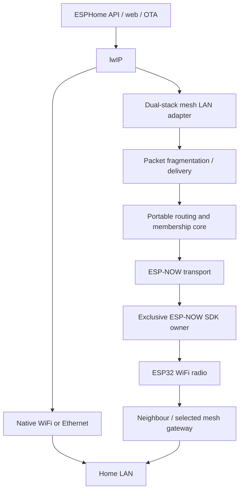

# Architecture

## Goal and scope

An ESPHome node prefers a usable native WiFi or Ethernet uplink. If that path becomes unavailable, the node can carry its IP traffic through other authenticated mesh participants to an eligible gateway on the same LAN. A client can bootstrap without a previous WiFi DHCP lease. This is node IP connectivity, not an arbitrary Ethernet-frame bridge for other attached devices. Ethernet support is implemented but untested.

## Portable core

`mesh_core`, `mesh_runtime`, `mesh_membership`, `mesh_session` and `mesh_endpoint` define routing, admission, session freshness and endpoint proofs without ESP-IDF radio calls. A bounded protocol format carries source/destination identities and boot/session information. Path vectors, TTL, sequence freshness and duplicate suppression bound forwarding and reject known loops or stale sessions; this is not a formal proof for every possible partition schedule.

Routes are selected by each node. The shortest policy retains a usable current path at equal depth and switches to a strictly shorter alternative. Stable retains a longer healthy mesh route too. A working native uplink has precedence. A returning neighbour does not justify resetting unrelated routes or active transfers.

## ESP-NOW boundary

`mesh_espnow_transport`, `mesh_radio_frame` and `mesh_esp32_platform` implement framing, bounded callback queues, channel/radio interaction and the ESP-IDF backend. SDK callbacks hand off work; a worker owns transport processing. Events wake the worker promptly, with bounded yielding under continuous traffic.

`espnow_driver` owns one exclusive ESP-NOW SDK lease and callback lifetime fencing. Mesh and stock `espnow` consumers cannot run simultaneously. Other radio backends would implement a transport boundary, but they would still need explicit MTU, addressing, timing and IP-adapter contracts; replacing a driver is not automatically sufficient for LoRa or 802.15.4.

## Membership and trust

Automatic mode uses one random shared 32-byte network key. Participants authenticate membership, establish session-bound link keys and use encrypted unicast for data. Management broadcasts are authenticated. Boot/session changes retire evidence tied to the old participant session. All holders of the shared key are trusted members; this is not per-user authorization or end-to-end application encryption. Keep normal API encryption and OTA authentication enabled.

Optional IDs, peer MACs and gateway lists restrict topology. They are unnecessary for the basic automatic setup. Tables and packet queues are bounded by compile-time capacity; the default is eight nodes and 512-byte ESP-NOW frames.

## LAN adapter and address ownership

`mesh_esp32_lan` selects the native LAN uplink independently of `mesh_esp32_platform`, which owns WiFi radio operations. Ethernet availability does not require association with an AP. The main task publishes Ethernet component state atomically; the worker follows ESPHome's native interface priority. The IP adapter alone attaches and restores IPv4/IPv6 hooks on the selected ESP-IDF netif.

Ethernet-enabled builds process intercepted LAN input through lwIP's normal TCP/IP input mailbox without copying the pbuf. Interface rebinding and packet processing share that owner, including packets queued before a switch. Changing the LAN interface invalidates LAN-bound leases, proxy grants, multicast memberships and queues while keeping authenticated membership and mesh routing. The generic network-provider contract is unchanged.

`mesh_ip_dhcp`, `mesh_ip_netif`, IPv6 helpers and `mesh_ip_discovery` adapt selected mesh paths to normal IP services. IPv4 DHCP requests use the node's station MAC through an eligible gateway. Matching DHCP evidence, conflict probes, fresh endpoint challenges and lease deadlines gate proxy ARP publication. A path change must not renew the address lifetime by itself.

IPv6 readiness and IPv4 readiness are separate. Generic network availability can be true for IPv6 while IPv4 DHCP is still pending. An unspecified IPv4 address must never be published as a usable IPv4 endpoint. IPv6 uses bounded SLAAC/ND-related handling; DHCPv6 and arbitrary multicast bridging are not provided.

The gateway advertises only current, authenticated and address-valid node endpoints. Name/service discovery is handled on the LAN edge. No Linux helper, DHCP server on an ESP, application proxy service or extra NAT subnet is required for the demonstrated firmware path.

The generic ESPHome connection-provider contract reports usable fallback connectivity. Mesh-specific route, key, lease and proxy state stays on the mesh side. The external overlay and the proposed upstream implementation differ in integration glue; their source identities are recorded separately.

## Native WiFi recovery

Explicit `wifi.disable`/`wifi.enable` intent is distinct from a temporary mesh-owned pause. A validated AP hint can avoid a scan, but cannot guarantee fast authentication or DHCP. Native acquisition and recovery have bounded 60-second ownership windows. This is an upper bound, not an artificial delay. Address-ownership withdrawal must complete before controlled native return advertises ownership again.

One PHY still has to stop or retune for some operations. Existing TCP connections can break across interface changes, and fresh connections may need to retry. Seamless radio service and a fixed outage duration are not promised.

## Upstream direction

See the [PR roadmap](UPSTREAM_PLAN.md). The generic network foundation, shared SDK ownership, WiFi integration, portable kernels and LAN adapters should be reviewed in small dependency-ordered changes. Repository notes supplement rather than replace a self-contained explanation and tests in each upstream PR.
